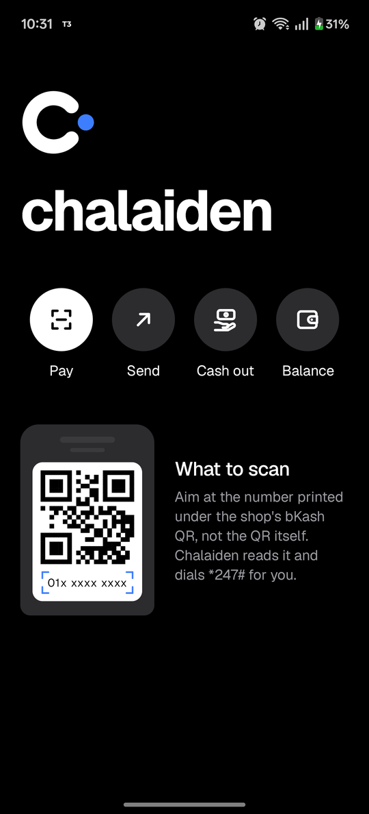
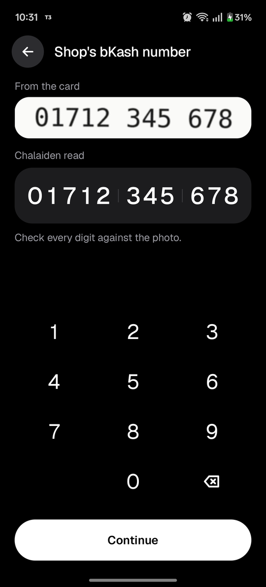
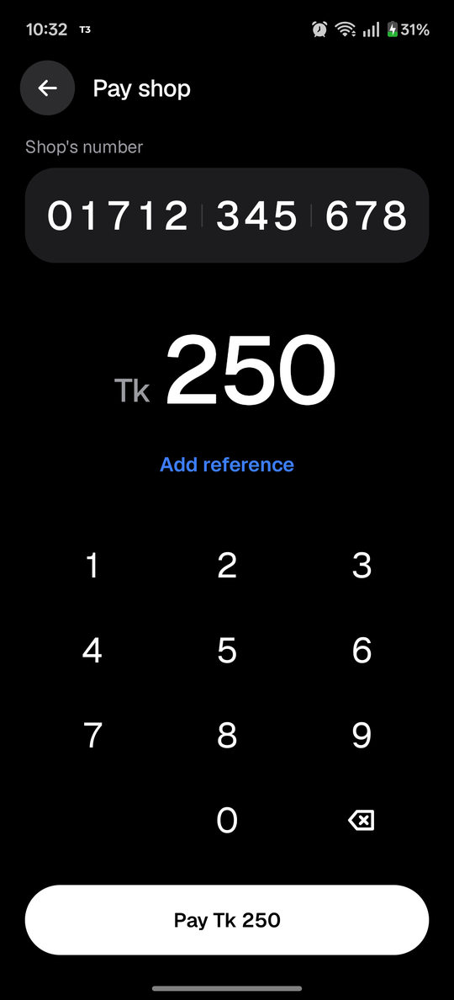
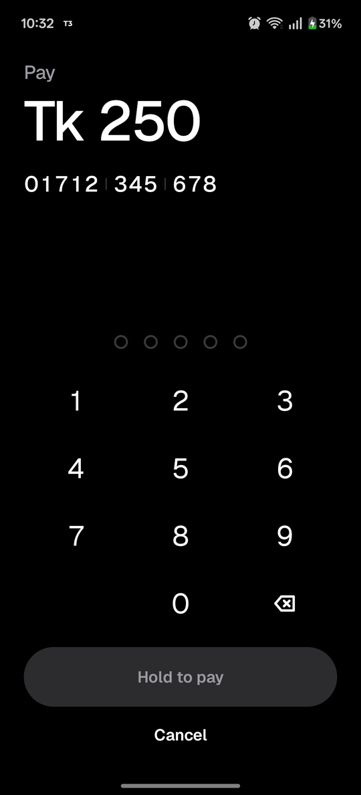

# Chalaiden

Pay with bKash when you have no internet.

<!-- TODO: demo video goes here once the screens are updated -->

  
  
  
  

## What it does

Chalaiden puts a clean screen in front of the bKash menu you dial with `*247#`. You can pay a shop (scan the bKash number on the shop's card or type it), send money, cash out, or check your balance, all with no mobile data.

It is not made by or connected to bKash, and it is not on the Play Store.

## How to install

1. Download the APK from the [latest GitHub release](https://github.com/inj-src/chalaiden/releases/latest).
2. Open it, allow installing from your browser if Android asks, and install.
3. Open Chalaiden and follow **Setup**.

No internet? A friend can send the app with **⋮ → Share Chalaiden** over Quick Share. Updates are checked in the app from GitHub Releases.

## First-time setup

Setup asks for phone access, your bKash SIM, and how Chalaiden should answer bKash:

- **Automatic** *(best for most people)*: turns on one Accessibility setting; no root needed.
- **Guided mode** *(under Advanced options)*: works on any phone. You type into bKash's own box with Chalaiden's helper.
- **Shizuku or Root** *(under Advanced options)*: other automatic options if you already use them.

## How a payment goes

Scan or type the number, enter the amount, type your PIN, and **hold** to pay. Chalaiden checks bKash's summary before sending your PIN, then shows bKash's reply.

If you want to skip typing your PIN, turn on **One Tap** (**⋮ → One Tap**) to save it locked to your fingerprint.

## Safety and privacy

- **No account, no history.** Nothing about your payments is saved.
- **Your PIN never leaves your phone except to bKash.** Normally you type it each time; with One Tap, it stays locked to your fingerprint.
- **Works offline.** Card scanning stays on your phone. Internet is only used to check for updates.

## FAQ

**Do I need internet?** No. `*247#` runs over your mobile signal with no mobile data.

**Is it from bKash?** No. Chalaiden is an independent, open-source app.

**What if bKash blocks Automatic?** Open **⋮ → Setup → Advanced options**, switch to **Guided mode** or **Shizuku**, and turn Chalaiden off in Accessibility settings.

## For developers

Build with `./gradlew assembleDebug` (JDK 17, Android SDK 36); the code is in [`app/src/main/java/com/chalaiden/app/`](app/src/main/java/com/chalaiden/app/).
