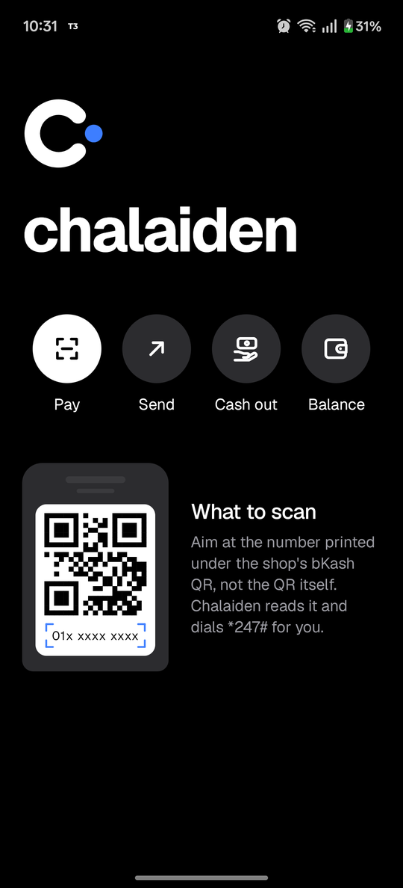
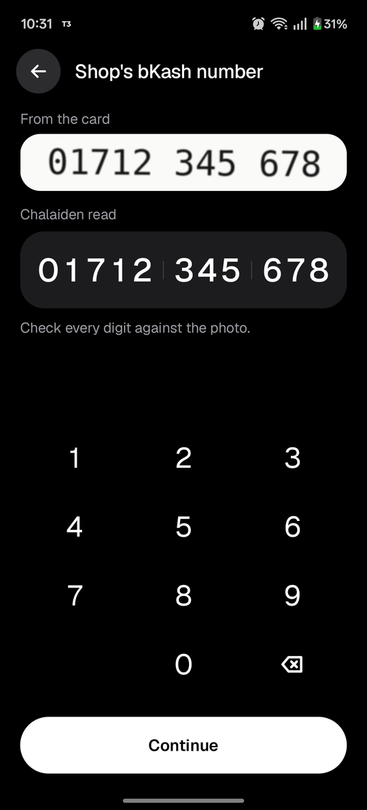
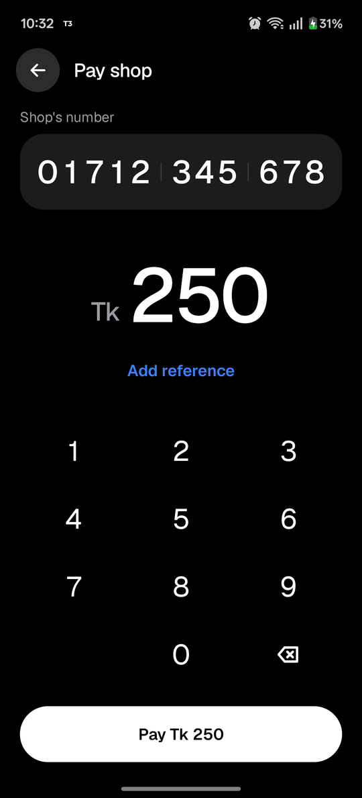
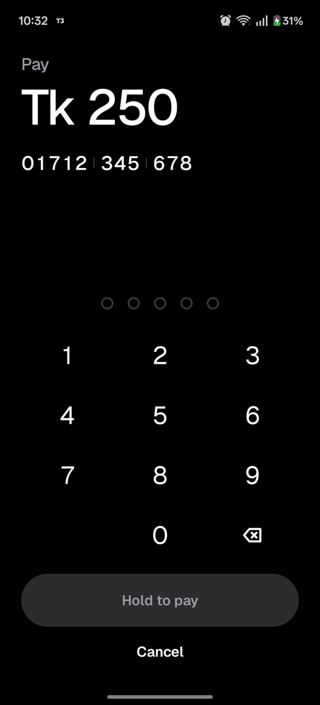
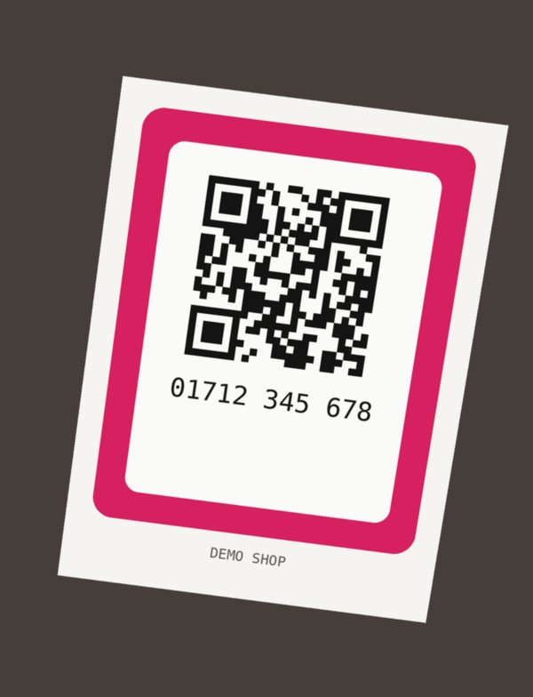

# Chalaiden

Pay a shop with bKash when there's no internet.

Chalaiden puts a clean, fast screen in front of bKash's `*247#` USSD menu. Scan the number on the
shop's card, type the amount, enter your PIN and hold to pay. Chalaiden walks the menu for you
behind its own screen and shows you bKash's answer. USSD runs over the mobile network, so it works
with no data at all.

<p align="center">
  
  
  
  
</p>

> [!IMPORTANT]
> Chalaiden needs a **rooted** phone. It isn't on the Play Store, and it isn't made by or
> affiliated with bKash.

## What it does

| | |
|---|---|
| **Pay** | Pay a shop (merchant payment). Scan the number under the shop's bKash QR, or type it. |
| **Send** | Send money to a person: type the number, paste it, or pick a contact. |
| **Cash out** | Cash out at an agent. |
| **Balance** | Check your bKash balance. |

## How it works

### 1. Read the number from the card



Point the camera at the number printed under the shop's QR (not the QR itself), or pick a photo
from the gallery. Text recognition runs on the phone (ML Kit); nothing is uploaded.

- **Live box.** While you aim, corner brackets jump onto the number and follow it. The shutter ring
  turns blue once a number is in view. Nothing happens until you press it.
- **Grouped like the card.** bKash cards print numbers in different ways: `01712 345 678` (5-3-3),
  `017 1234 5678` (3-4-4), digits in boxes, and so on. Chalaiden measures the gaps between the digits
  and groups the number the same way, so you can compare it with the card at a glance. If the
  spacing isn't clear, it falls back to 3-4-4.
- **Straightened photo.** The strip the number was read from is cut out along the card's own tilt
  and flattened, so it reads like a scan next to what Chalaiden read. Check every digit before you
  continue; you can fix any of them with the keypad.

The tilted demo card on the right comes out as the straight strip in the second screenshot above.

<br clear="right">

### 2. Amount, PIN, hold to pay

Type the amount (and a reference, if you want one), then your bKash PIN, and **hold** the button to
pay. Letting go early cancels. To save time, Chalaiden opens `*247#` as soon as you type the first
PIN digit, so bKash's summary is usually ready by the time the hold completes.

### 3. Chalaiden answers bKash for you

Behind its own full-screen cover, Chalaiden reads each USSD dialog and answers it:

1. Picks the menu entry by its **label** (Payment, Send Money, Cash Out…), so a reordered menu still
   works.
2. Types the number, amount and reference into the prompts that ask for them.
3. Reads bKash's **summary** and checks it: the recipient and the amount must match what you
   entered. If bKash adds a fee, or the fee can't be read, you see the summary and confirm again.
4. Only then sends your PIN, and shows bKash's reply: success with the transaction ID, or the reason
   it failed.

If anything doesn't match or a dialog changes unexpectedly, Chalaiden cancels the session rather
than guess. It closes dialogs with **Cancel**, never Send.

### Under the hood

- **Root, no Accessibility service.** A small helper (`helper/UiHelper.kt`) runs as root through
  `app_process` for the length of one session and holds a single UI Automation connection. That
  makes reading a dialog take milliseconds. If the helper can't start, Chalaiden falls back to
  `uiautomator dump` and key events. Nothing is registered as an Accessibility service.
- **A cover above the dialogs.** The run screen is drawn in a "draw over other apps" window that
  takes touches (your PIN pad, Cancel) but not keys, so the typed replies still reach the phone's
  dialog underneath.
- **Keyboards off during a session.** The USSD reply box would pop the keyboard above the cover, so
  keyboards are switched off for the session and put back afterwards. They're also restored on the
  next launch if a session was killed.
- **Your PIN stays in memory.** It's never written to disk or logged, and it's only sent once bKash's
  summary matches. Each PIN reply names the exact prompt it answers; if that prompt has gone, the
  PIN isn't sent.

## Requirements

- Android 8.0 or newer (developed on Android 16, OnePlus / OxygenOS)
- Root (APatch, Magisk or KernelSU)
- A SIM with a bKash account. The menu flows were checked on Grameenphone.

On first use, the setup screen asks for:

| Permission | Why |
|---|---|
| Phone | Dial `*247#` on the right SIM and list your SIMs |
| Root | Read and answer the USSD dialogs. With root, Chalaiden also allows itself to draw over other apps, to keep its screen above the phone's dialogs |
| Camera | Scan the shop's number (asked when you first scan; you can pick a photo or type the number instead) |

Without root, Chalaiden can still show you the exact replies to type, in order, so you can do it by
hand.

## Build

You need JDK 17 and the Android SDK (compile SDK 36).

```sh
./gradlew assembleDebug          # app/build/outputs/apk/debug/app-debug.apk
./gradlew testDebugUnitTest      # unit tests
adb install -r app/build/outputs/apk/debug/app-debug.apk
```

## Project layout

```
app/src/main/java/com/chalaiden/app/
├── MainActivity.kt        Screens and navigation
├── ui/                    Compose screens: home, scanner, number, amount, run, result, setup
├── ocr/                   Number reading: ML Kit, digit grouping, straightened crop
├── ussd/                  The *247# engine, flows, root driver, dialog readers
└── helper/UiHelper.kt     Root helper process (UI Automation over stdin/stdout)
```

`ussd/UssdEngine.kt` is the state machine that decides what to answer at each step. It's plain
Kotlin and is covered by `UssdEngineTest`. `ocr/NumberLayout.kt` (digit grouping) is covered by
`NumberLayoutTest`.

## Limitations

- bKash's USSD menu wording may differ by operator or change over time. Flows match menu entries by
  label, and the menu was checked on Grameenphone.
- bKash seems to refuse a new session that starts within about 30 seconds of the last one; the result
  screen's Retry waits that out.
- Not for the Play Store: it needs root and draws over other apps.

The screenshots use a made-up demo card and number.
